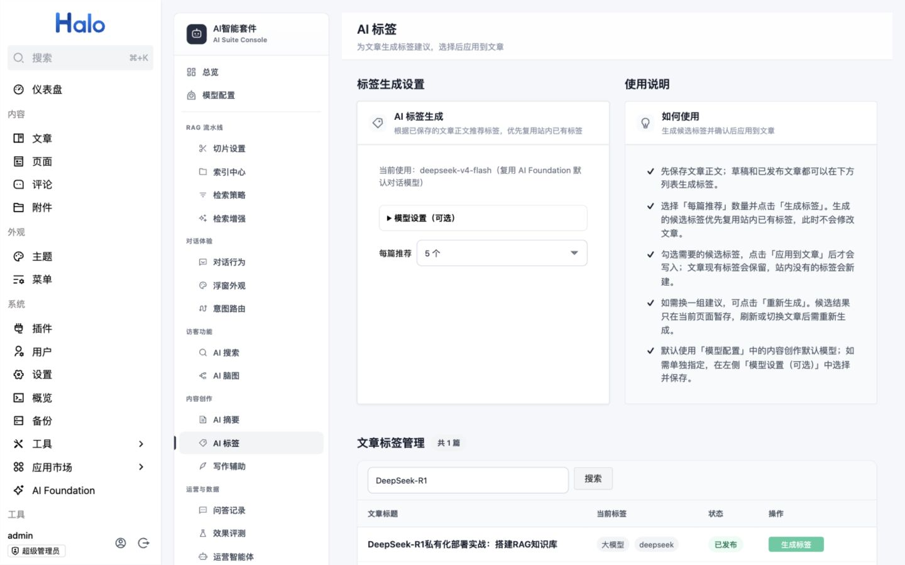
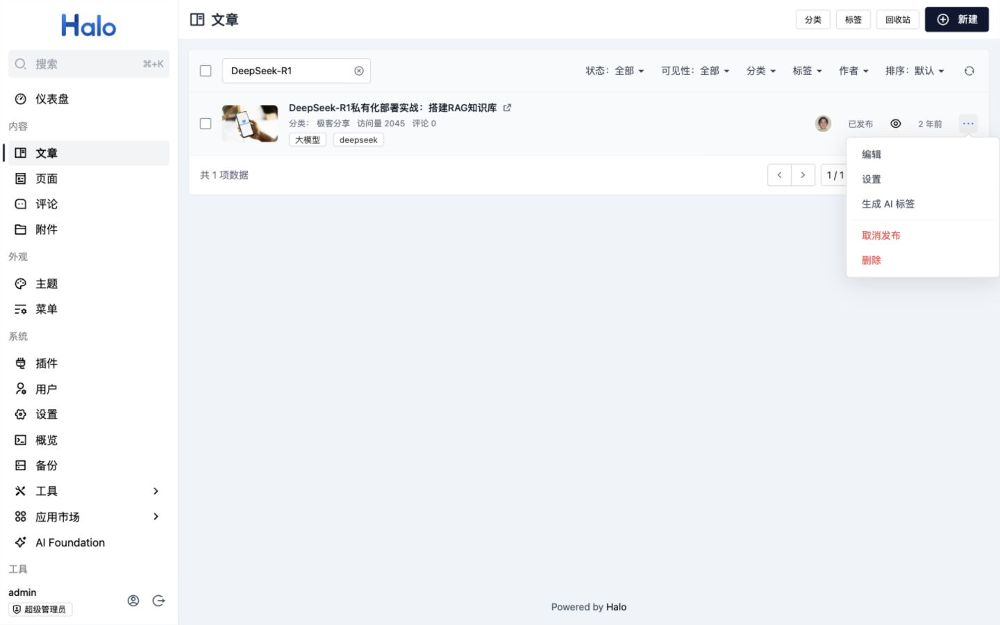

# AI 标签

> 适用读者：Halo 作者、内容运营人员  
> 发布状态：本地开发分支已实现，尚未包含在已发布的 0.4.1 JAR 中

AI 标签根据文章已保存的正文生成候选标签。生成阶段只给建议；选择并点击“应用到文章”后才会修改文章。

## 从哪里使用

- 在“AI 智能套件 → 内容创作 → AI 标签”中搜索文章、查看当前标签并生成建议。草稿和已发布文章均可使用。
- 在 Halo 文章列表的单篇操作菜单中点击“AI 生成标签”，直接打开当前文章的弹窗。弹窗会自动开始生成，无需跳转到 AI 标签页面。

文章编辑页的标签下拉菜单中没有 AI 生成按钮。请先保存正文，再到上述任一入口操作；未保存的编辑器内容不会用于生成。

## 生成和应用

1. 选择每篇推荐数量（3～8 个），点击“生成标签”；文章列表弹窗打开时会自动生成。
2. 检查候选标签和“已有 / 新建”标记。插件优先复用站内已有标签，并排除文章当前已有的标签。
3. 勾选需要的候选标签，点击“应用到文章”。现有标签会保留；站内没有的标签会新建并关联到文章。
4. 建议不合适时点击“重新生成”。候选结果只在当前界面暂存，刷新或切换文章后需要重新生成。

生成请求会把文章标题、最多 6000 个字符的正文、最多 150 个站内已有标签名称，以及文章当前标签名称发送给所选模型服务商，可能产生费用。应用候选标签本身不调用模型，但会修改 Halo 的文章与标签资源。

## 模型选择

默认复用“模型配置 → 内容创作模型”。需要为标签单独指定模型时，展开 AI 标签页的“模型设置（可选）”，选择 AI Foundation 中可用的语言模型并保存。弹窗使用同一套标签模型配置。

留空的回退顺序为：标签模型 → 内容创作默认模型 → 对话模型 → AI Foundation 默认语言模型。AI 摘要和写作辅助也可分别覆盖内容创作默认模型；详见[配置参考](../reference/configuration-reference.md#模型配置-models)。

## 排查问题

- 提示“文章正文为空”：先保存文章正文，再重新生成。
- 候选为空或提示模型未返回可用标签：检查正文内容，或重新生成；模型输出格式异常时也可能发生。
- 模型调用失败：检查 AI Foundation 模型是否可用，以及“模型配置”和 AI 标签页中选择的模型。
- 应用前请核对候选名称；新标签会进入站内标签库。若模型建议不准确，可取消勾选。

用量场景记为 `tag_generate`；相关接口见 [Console API](../api/console-api.md#ai-标签)。
